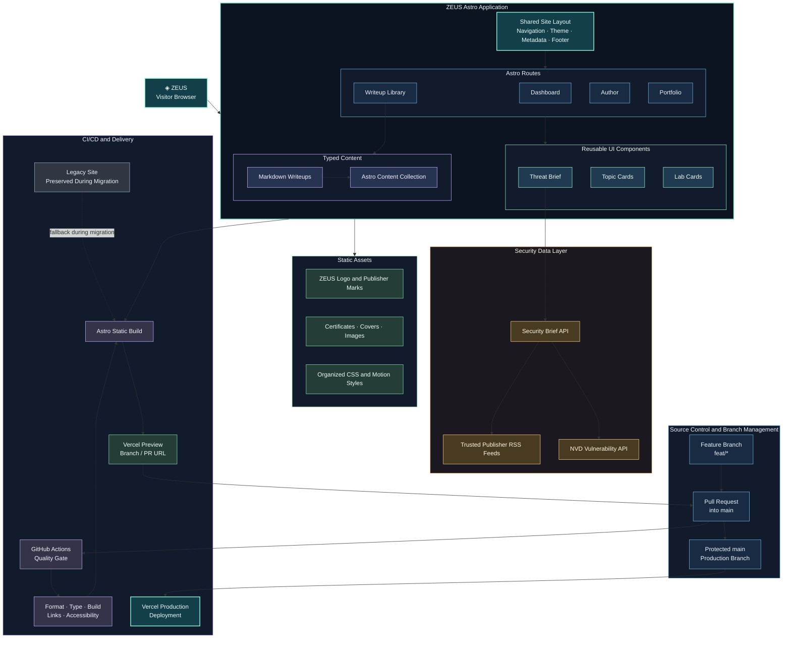

# ZEUS Portfolio Architecture

## High-level system diagram

## Color system

| Color | Meaning |
| --- | --- |
| Teal | ZEUS brand and shared application shell |
| Blue | Page routes |
| Mint | Reusable UI components |
| Violet | Content and build architecture |
| Amber | External security data |
| Green | Assets and branding |
| Gray-violet | Delivery and migration infrastructure |

## Architecture notes

- Astro owns the new page structure and production build.
- A shared layout owns navigation, theme controls, metadata, and the footer.
- Markdown writeups will become typed content rather than manually maintained HTML.
- The threat feed remains a separate serverless/API concern.
- Existing CSS, images, and legacy pages remain available until the Astro version is verified.
- GitHub Actions is the central quality gate for formatting, types, links, accessibility, and the production build.
- Feature branches are reviewed through pull requests and must pass required checks before merging.
- Vercel creates preview deployments for branches and pull requests, while protected `main` produces the production deployment.
